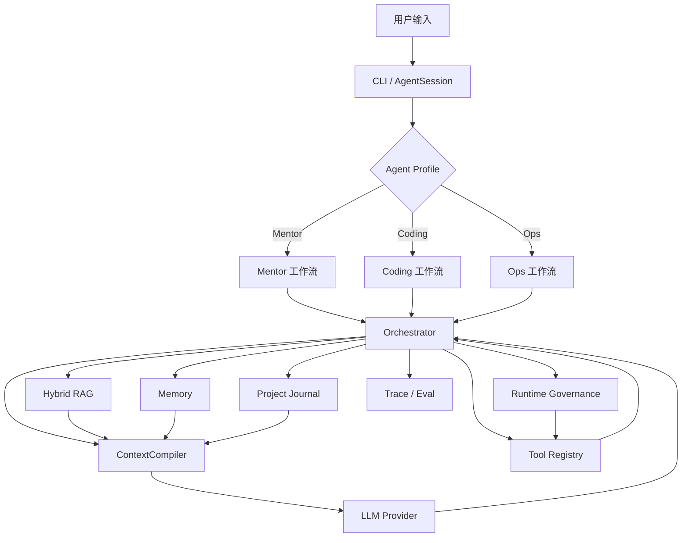

# Klonet Agent

> 面向 Klonet 教学、开发与运维场景的多角色智能协作 Agent。

[项目简介](#项目简介) · [核心能力](#核心能力) · [系统架构](#系统架构) · [快速开始](#快速开始) · [测试与评估](#测试与评估) · [版本更新](#版本更新)

Klonet Agent 不是一个换了提示词的通用聊天机器人。它围绕 Klonet 项目的知识学习、代码开发、运行维护和过程验收，提供 **Mentor、Coding、Ops** 三种职责明确的工作模式，并将 RAG、长期记忆、项目日志、上下文治理、安全工具和评测体系整合到同一套轻量 Agent Runtime 中。

项目当前以交互式 CLI 运行，适合作为课程设计、Agent 工程实践和面向垂直领域的智能协作系统原型。

## 项目简介

通用 Coding Agent 能阅读和修改代码，但通常不了解 Klonet 的领域知识、开发规范、部署方式和课程验收要求。每次会话都从零理解项目，也很难持续记录不同用户的开发进度与历史问题。

Klonet Agent 针对这些问题做了四层增强：

- **领域化**：将 Klonet 架构、源码、操作手册和历史故障整理为可检索知识库。
- **角色化**：不同 Profile 使用不同提示词、工具权限和默认工作流，避免答疑、开发和运维相互越权。
- **过程化**：用项目日志、任务计划、测试结果和验收差异记录完整开发过程。
- **工程化**：用上下文预算、结构化证据、运行治理、trace 和 eval 控制 Agent 的成本、风险与可验证性。

### 三种工作模式

| 模式 | 定位 | 典型任务 | 权限边界 |
| --- | --- | --- | --- |
| `mentor` | Klonet 数字导师 | 知识问答、源码解释、故障分析、项目进度理解 | 默认只读，不直接修改业务代码 |
| `coding` | 编程协作助手 | 任务规划、代码修改、测试、diff、项目日志与轻量 review | 仅在受控 workspace 内读写和执行测试 |
| `ops` | 运维诊断 Agent | 环境盘点、运行态检查、日志定位、变更计划与验收 | 只读证据优先；环境变更必须经过结构化计划、审批与验证 |

三个模式共享会话、知识、记忆、工具和追踪基础设施，但通过 [`AgentProfile`](agents/profile.py) 隔离行为与能力。

## 核心能力

### 1. 多角色 Agent Runtime

- 使用统一 Orchestrator 驱动模型、工具调用、任务状态和结果整理。
- Prompt 按核心身份、安全规则、模式规则、代码风格和任务规则分层组合。
- `user_id + project_id + mode` 构成会话边界，支持不同用户与项目独立运行。

### 2. Klonet 混合 RAG

- 检索对象覆盖领域文档、操作手册、源码索引、项目日志和历史经验。
- 支持关键词、BM25 与向量召回，并通过 query planning、collection routing 和 rerank 组织多阶段检索。
- 将公共领域知识与用户私有项目资料分层，减少跨项目信息混用。

### 3. 上下文预算与任务恢复

- 每次模型调用前由 `ContextCompiler` 按模型窗口、输出预留和安全余量编译上下文。
- 以完整对话回合和工具交换为裁剪单位，避免孤立的 tool call / tool result。
- 超过软阈值后生成结构化 `TaskCheckpoint`；超过硬阈值时在本地拒绝发送。
- 编译结果记录各区域 token 占用，便于定位上下文膨胀。

### 4. 长期记忆与项目日志

- 支持 Markdown / JSONL 本地记忆，以及 PostgreSQL + pgvector 记忆仓库。
- 记忆写入经过候选提取、写入策略、版本决策、幂等落库和审计链路。
- 每个用户、每个项目拥有独立 Markdown 日志：`journals/{user_id}/{project_id}.md`。
- 日志持续记录目标、计划、执行过程、问题、测试结果、验收差异和下一步。

### 5. 安全工具与运行治理

- 文件工具受 workspace 边界约束，并对危险命令和敏感路径进行拦截。
- Ops 模式以运行态证据为事实来源，将 Discovery、Planning、Binding、Execution、Checking 和 Verification 分离。
- 高风险操作不能只靠自然语言确认；审批与计划 ID、内容哈希和持久化状态绑定。
- 允许注册 Action 和受控 Shell 兜底，但都必须经过统一合同、安全校验与审计边界。

### 6. 可观测性与评估

- trace 记录模型调用、token、耗时、工具执行状态和结果摘要。
- `evals/` 提供 Mentor、Coding、错误处理、RAG、上下文管理、记忆和 Ops 能力评测。
- 专项报告保留 case、预算、证据与回归结果，便于对比不同策略。

## 系统架构



核心调用关系：

```text
用户输入
  → 选择 Profile 与工具权限
  → 检索领域知识 / 项目证据 / 长期记忆
  → ContextCompiler 按预算组装上下文
  → 模型判断、工具循环与结果验证
  → 写入 history、journal、memory 与 trace
```

## 快速开始

### 环境要求

- Python 3.10+
- 一个支持 OpenAI API 格式的聊天模型服务
- 可选：PostgreSQL + pgvector，用于数据库记忆后端
- 可选：Tesseract 与 Poppler，用于 OCR 和 PDF 页面处理

### 1. 获取代码并创建环境

```bash
git clone https://github.com/lht94/klonet_agent.git
cd klonet_agent
python -m venv .venv
```

激活虚拟环境：

```bash
# Linux / macOS
source .venv/bin/activate

# Windows PowerShell
.venv\Scripts\Activate.ps1
```

安装依赖：

```bash
python -m pip install --upgrade pip
python -m pip install -r requirements.txt
```

### 2. 配置模型

在项目根目录创建 `.env`：

```dotenv
CHAT_LLM_API_KEY=<your-api-key>
CHAT_LLM_BASE_URL=<your-openai-compatible-endpoint>
CHAT_LLM_MODEL=<your-model-name>
```

更多供应商、超时、重试、上下文窗口与记忆配置见 [`config.py`](config.py)。不要提交真实密钥。

### 3. 启动 Agent

```bash
# 知识问答与学习辅导
python -m klonet_agent.agent --mode mentor --user-id demo --project-id klonet-demo

# 代码开发与测试协作
python -m klonet_agent.agent --mode coding --user-id demo --project-id klonet-demo

# Klonet 环境诊断与受控运维
python -m klonet_agent.agent --mode ops --user-id demo --project-id klonet-demo
```

查看完整参数：

```bash
python -m klonet_agent.agent --help
```

### 4. 运行测试

```bash
python -m pytest -q
```

Ops 相关测试和功能面向 Linux/Klonet 运行环境，建议在 Ubuntu 上进行完整验证。

## 使用示例

### Mentor：理解系统

```text
Klonet 的 master、worker 和 celery 分别负责什么？
请结合知识库解释拓扑部署失败时的排查顺序，并标注证据来源。
```

### Coding：完成开发任务

```text
读取当前项目日志，为后端接口增加参数校验。
先查找相似实现，再做最小修改、运行相关测试并展示 diff。
```

### Ops：诊断运行环境

```text
检查当前 Klonet 平台的进程、端口、Screen 会话和最近错误日志。
先只读诊断，不要修改环境；给出证据、根因和下一步建议。
```

## 项目结构

```text
klonet_agent/
├── agent.py              # CLI 入口
├── orchestrator.py       # 主编排与工具循环
├── session.py            # 用户、项目、模式与任务状态
├── prompts.py            # 分层 Prompt
├── agents/               # Mentor / Coding / Ops Profile
├── context/              # token 预算、消息分组与上下文编译
├── knowledge/            # 文档/源码索引与混合 RAG
├── memory/               # checkpoint、长期记忆与 PostgreSQL 后端
├── journal/              # 项目 Markdown 状态机
├── workspace/            # 工作区管理与沙箱
├── tools/                # 文件、源码、环境、终端与 Web 工具
├── ops/                  # 运维证据、计划、审批和执行链
├── runtime/              # Agent 运行治理
├── tracing/              # trace 与 Jev 记录
├── evals/                # 评测集和评测报告
├── tests/                # 自动化测试
└── docs/ / doc/          # 开发规范、设计与运维文档
```

## 技术栈

| 领域 | 方案 |
| --- | --- |
| Agent Runtime | Python、自研轻量工具循环、Profile 隔离 |
| 模型接入 | OpenAI-compatible API、多供应商路由 |
| 检索 | JSONL 索引、jieba、BM25、向量召回、rerank |
| 上下文 | 模型预算、完整消息组、结构化 checkpoint |
| 记忆 | Markdown / JSONL、PostgreSQL、pgvector |
| 文档处理 | python-docx、python-pptx、pdfplumber、pypdf、OCR |
| 工程保障 | pytest、trace、专项 eval、Git diff |

## 测试与评估

项目同时使用单元测试、离线 case 和专项评测：

- [`evals/summary.md`](evals/summary.md)：Mentor、Coding 与错误处理基础样例。
- [`evals/context_management_summary.md`](evals/context_management_summary.md)：上下文预算、压缩、硬拒绝和重启恢复评测。
- [`evals/memory_summary.md`](evals/memory_summary.md)：记忆写入、召回与生命周期评测。
- [`evals/retrieval_summary.md`](evals/retrieval_summary.md)：知识检索效果汇总。
- [`evals/agent_real_user_capability/README.md`](evals/agent_real_user_capability/README.md)：真实用户能力验证入口。

上下文管理专项评测覆盖 8 个场景，包括长工具结果、多工具调用、中断工具链、长输入、Ops 对话、硬溢出和 checkpoint 重启恢复；完整数据以仓库中的评测报告为准。

## 文档导航

| 文档 | 内容 |
| --- | --- |
| [`docs/DEVELOPMENT_GUIDELINES.md`](docs/DEVELOPMENT_GUIDELINES.md) | 当前权威开发规范与架构边界 |
| [`doc/00_project_overview.md`](doc/00_project_overview.md) | 项目背景、目标与差异化价值 |
| [`doc/02_architecture_design.md`](doc/02_architecture_design.md) | 分层架构与 Profile 设计 |
| [`doc/16_context_management_upgrade.md`](doc/16_context_management_upgrade.md) | ContextCompiler 设计与验证 |
| [`doc/17_memory_lifecycle_operations.md`](doc/17_memory_lifecycle_operations.md) | 记忆生命周期运维说明 |
| [`doc/18_runtime_governance_upgrade.md`](doc/18_runtime_governance_upgrade.md) | Agent 运行治理升级 |
| [`docs/ops/klonet-agent-op-install.md`](docs/ops/klonet-agent-op-install.md) | Ubuntu 专用账户与 Ops 部署 |
| [`knowledge/klonet/README.md`](knowledge/klonet/README.md) | Klonet 领域知识库入口 |

开发或让 Coding Agent 修改本项目之前，请先阅读 [`docs/DEVELOPMENT_GUIDELINES.md`](docs/DEVELOPMENT_GUIDELINES.md)。当前代码、结构化合同和自动化测试的优先级高于带日期的历史设计稿。

## 当前状态与限制

- 当前主要入口是交互式 CLI，尚未提供完整 Web UI 或公共在线 Demo。
- 高权限 Ops 执行依赖 Ubuntu、专用系统账户、受控 helper 和明确的部署配置。
- PostgreSQL 记忆、OCR、向量模型等高级能力需要额外服务或系统依赖。
- 仓库包含持续演进的实验与评测文档；历史设计稿应以当前代码和开发规范为准。

## 版本更新

以下内容简要记录项目从教学协作原型到完整 Agent 工程的主要版本演进。

<details>
<summary><strong>上下文管理：从无限 history 到 ContextCompiler</strong></summary>

```text
history.jsonl 持续记录不可变事件
  → 按模型预算编译 system / checkpoint / evidence / history / tools
  → 超过软阈值时生成结构化 TaskCheckpoint
  → checkpoint 与预算内最近完整回合继续任务
  → 必需区超过硬阈值时本地拒绝发送
```

当前实现以完整消息组为裁剪单位；checkpoint 支持版本化原子写入与损坏回退；`context_compile` trace 会记录分区 token 和预算决策。

```dotenv
KLONET_AGENT_DISABLE_CONTEXT_COMPILER=1
KLONET_AGENT_CONTEXT_WINDOW=131072
KLONET_AGENT_MAX_OUTPUT_TOKENS=8192
KLONET_AGENT_SAFETY_MARGIN_TOKENS=4096
KLONET_AGENT_SOFT_LIMIT_RATIO=0.7
```

详见 [`doc/16_context_management_upgrade.md`](doc/16_context_management_upgrade.md)。

</details>

<details>
<summary><strong>知识检索：从本地 JSONL 到多阶段混合 RAG</strong></summary>

```text
检索必要性判断
  → Query Planning / Expansion
  → Collection Routing
  → 关键词 + BM25 + 向量召回
  → Rerank / 证据组织
  → 按上下文预算注入
```

知识来源包括 Klonet 架构、开发规范、部署流程、常见故障、源码索引、项目日志和历史案例。`knowledge/klonet/` 保存公共领域知识，用户 workspace、journal 和 memory 保持独立边界。

</details>

<details>
<summary><strong>记忆系统：从 Markdown 记录到版本化 PostgreSQL</strong></summary>

本地模式仍可使用 `history.jsonl`、`USER.md`、每日记忆和 `MEMORY.md`。数据库模式将长期记忆拆成四层：

| 层 | 主要模块 | 职责 |
| --- | --- | --- |
| 领域 | `memory/domain.py` | 定义合法记忆、类型、作用域和 subject |
| 契约 | `memory/repository.py` | 定义仓库能力和 embedding 合同 |
| 存储 | `memory/postgres.py`、`migrations/` | 连接池、租户事务、RLS 与不可变记录 |
| 决策 | `memory/versioning.py` | ADD / UPDATE / SUPERSEDE / NOOP / REJECT |

写入链路由候选提取、写入策略、版本决策和幂等 pipeline 组成；召回链路包含向量查询、rerank 回退、冲突标注和 token 预算构包。Embedding 通过 outbox worker 异步补算。

详见 [`doc/15_memory_postgres_deployment.md`](doc/15_memory_postgres_deployment.md) 与 [`doc/17_memory_lifecycle_operations.md`](doc/17_memory_lifecycle_operations.md)。

</details>

<details>
<summary><strong>Ops：从命令工具到证据驱动的运行治理</strong></summary>

```text
意图候选
  → Coordinator 核对持久化状态
  → Discovery 收集只读证据
  → Evidence Synthesis
  → Planner 描述语义变更
  → Binder 绑定注册 Action / ShellArtifact
  → 人工审批
  → Executor 单次执行
  → Checker 验证后置条件
  → Verifier 判断目标是否达成
```

运行态证据高于历史对话、RAG 和静态文档。Planner 不负责选择命令，Executor 不负责判断目标完成，只有 Verifier 可以产生目标级结果。未注册的长尾能力仍须经过风险策略、冻结合同、人工确认与审计。

</details>

<details>
<summary><strong>模型供应商与运行配置</strong></summary>

聊天模型统一通过 `llm.LLMClient` 和 `ProviderRouter` 调用，支持 OpenAI-compatible endpoint、按时间路由、备用密钥、超时和限流退避。Embedding 与 rerank 使用独立配置。

```dotenv
CHAT_LLM_API_KEY=<your-primary-api-key>
CHAT_LLM_BASE_URL=<your-primary-endpoint>
CHAT_LLM_MODEL=<your-primary-model>
CHAT_LLM_MIN_TIMEOUT_SECONDS=90

PARATERA_API_KEY_1=<your-secondary-api-key>
PARATERA_BASE_URL=<your-secondary-endpoint>
PARATERA_MODEL=<your-secondary-model>
PARATERA_MIN_TIMEOUT_SECONDS=120

DEFAULT_LLM_TIMEOUT_SECONDS=60
DEFAULT_LLM_MAX_RETRIES=0
LLM_NIGHT_TIMEZONE=Asia/Shanghai
LLM_NIGHT_START_HOUR=21
LLM_NIGHT_END_HOUR=9
```

密钥轮换只用于认证、额度或限流类供应商错误，业务合同错误不会通过换钥掩盖。

</details>
